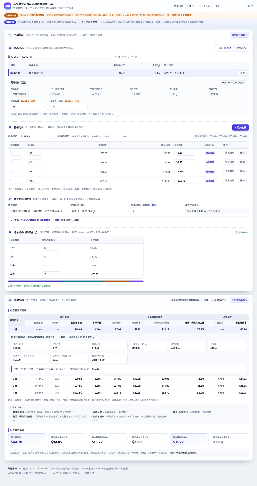

# 商品套餐定价与订单成本测算工具（Demo）
> **⚠️ 公开脱敏版**
>
> 本仓库为 **public** 仓库。随包数据中的 **SPU 采购成本** 与 **物流渠道价目表单价** 已由 `tools/sanitize_data.py` 替换为**合成样例值**（同一输入必得同一输出，可重复生成）。
> 商品编码 / 名称 / 重量 / 是否带电 / 重量段区间 / 渠道与目的地覆盖，以及**全部定价与成本计算规则**，与内部真实版**完全一致**；
> 但**金额数值不代表任何真实报价，不得用于业务决策**。内部真实数据版本未随本仓库发布。

一个**可真实交互、真实计算**的电商套餐定价与订单成本测算工具。

- 样例商品数据：1369 条 SPU（采购成本、重量、是否带电）
- 样例物流规则：446 条「渠道 × 目的地 × 重量段」计价规则，4 个渠道、29 / 82 / 72 / 2 个目的地
- 纯前端、零依赖、可离线运行
- 定价 / 成本 / 物流 / 占比加权全部真实计算，且每一笔运费都可追溯到具体重量段与算式

---

## 界面预览



> 以上为**样例数据**下的完整工作台：SPU KD00181（葡萄酒伴侣瓶 ¥47.78 / 350 g，不带电 → 默认渠道「云途全球专线挂号（特惠普货）」）、单件售价 19.99 USD、目的国家/地区 美国。重量段规则表按左开右闭 **(min, max]** 展示，展开行中的运费明细可追溯到命中的重量段与完整算式。

## 快速开始

### 方式一：直接打开（最简单）

双击 `index.html` 即可。纯静态页面，无需安装、无需构建、无需联网。

> 若浏览器对 `file://` 有限制（例如某些环境下 `fetch`/模块加载被拦截），改用方式二。

### 方式二：本地 HTTP 预览（推荐）

```powershell
cd E:\Codex\Ecom\pricing-tool
python tools\serve.py
# 浏览器打开 http://127.0.0.1:8766/index.html
```

`tools/serve.py` 只做静态文件托管，不含任何业务逻辑。默认端口 8766，可用 `python tools\serve.py 9000` 换端口。

### 方式三：任意静态服务器

```powershell
npx serve .          # 或 php -S 127.0.0.1:8766 / nginx / IIS 静态站点
```

---

## 5 分钟上手

> 页面只有两大区：**上面「测算输入」填条件，下面「测算结果」看结果**。所有输入项都集中在上方一个面板里（分为 4 组：商品信息 / 套餐定价 / 物流与其他成本 / 订单结构），不需要在页面里来回找。

1. **商品信息** —— 在「选择 SPU」搜索框输入 `KD00181` 或商品名，回车选中（匹配列表里能看到商品的录入时间与是否带电）；也可切到「手动录入」自己填名称、采购成本、重量、是否带电。选中 SPU 后台账字段为只读，改数据请用「手动录入」；**「是否敏感」「是否尺寸超限」台账里没有，是选填项，SPU 与手动录入两种模式下都能直接选**。
2. **物流** —— 渠道会按商品属性自动选好（优先级：尺寸超限 > 带电 > 敏感 > 其他）：**尺寸超限 → 云途中包专线挂号(特惠普货)**、**带电 → 云途全球专线挂号（特惠带电）**、**敏感 → 极通环球专线-标准定制敏感**、**其余 → 云途全球专线挂号（特惠普货）**，可再手工切换；然后选目的国家/地区。
3. **售价** —— 填「单件售价」（例如 19.99 USD）与「单件折扣率」（默认 50%），1/2/3/4 件套餐售价自动按折扣率算出（右侧会显示默认售价，可直接改）。
4. **广告成本** —— 可选。填了所有套餐总成本都会加上这一个金额；不填则不计入。
5. **改价** —— 想给某个套餐单独定价？直接改它的售价框，它会标记为「手动」，之后改单件售价时不会被覆盖，点「恢复自动」即可回退。
6. **加套餐 / 加占比** —— 可增删套餐数量档；填各档购买占比（合计 100%）后，结果区下方出现加权汇总指标卡（预计客单价、平均每单采购/物流/广告/总成本、平均每单购买数量）。**占比是选填的**，不填也能正常测算单个套餐。
7. **查运费来源** —— 展开测算表任意一行的「运费明细」，可以看到命中的重量段、件价、计重单价、生效日期和完整算式。
8. **看结果表** —— 结果表逐行给出每个套餐的**套餐客单价、客单系数、物流+采购费用、物流+采购费用占比**、广告成本与套餐总成本，可直接横向对比 1~4 件套餐的定价效果。

---

## 第三轮更新（2026-11-26）

| 变更 | 说明 |
| --- | --- |
| SPU 数据整体替换 | 旧文件《SPU信息-261101~261126.xlsx》（465 条）已删除，替换为《SPU信息-260901~261126.xlsx》，**1369 条**，SPU 编码无重复 |
| 新增 `elec` 带电属性 | 带电 → 默认渠道「云途全球专线挂号（特惠带电）」；不带电 → 默认渠道「云途全球专线挂号（特惠普货）」（该两级规则**已被下方第二轮的四级规则取代**）。**注意：当前数据集 `elec` 全为 0（不带电），故实际运行全部落到「特惠普货」** |
| 移除商品长 / 宽 / 高 | 商品信息表单与数据层不再保留该字段 |
| 录入时间仅列表展示 | 「录入时间」只在 SPU 匹配列表中作为一列展示，不再作为表单项 |
| 商品信息交互简化 | 只保留「选择已有 SPU」与「手动录入」两种方式；SPU 模式下字段只读，去掉了空白商品 / 系统数据 / 手动调整逻辑 |
| 修复购买占比输入 | 输入框改为标准左→右累积（输入 `4` 得 `40`，`Home` 后输入 `5` 得 `540`） |

## 第二轮更新（2026-11-26）

| 变更 | 说明 |
| --- | --- |
| 重量段语义改为**左开右闭** `(min, max]` | `min < 重量 ≤ max` 才命中。**200 g 现在命中「0.10~0.20」区间**，即 `(0.1, 0.2]`（普货·美国：计重 ¥122.79/kg、件价 ¥17.39/件）。段展示、trace 文案同步改为 `(min, max]` |
| 新增「是否敏感」「是否尺寸超限」 | SPU 台账里没有这两列，属于**用户手填的选填项**；SPU 模式下也可直接选 |
| 默认渠道匹配规则升级 | 优先级：**尺寸超限 → 云途中包专线挂号(特惠普货)** › **带电 → 云途全球专线挂号（特惠带电）** › **敏感 → 极通环球专线-标准定制敏感** › **其他 → 云途全球专线挂号（特惠普货）**。手工改了渠道且与商品属性不符时给出明确提醒 |
| 物流规则数据整体替换 | 旧文件《物流渠道计价规则-云图普电-1126最新生效.xlsx》（388 条 / 2 渠道）已清除，替换为《物流渠道计价规则-1126最新生效.xlsx》（**446 条 / 4 渠道**）。新文件是旧文件的**超集**：原 388 条规则的价格与分段**完全未变**，新增「云途中包专线挂号(特惠普货)」（45 条）与「极通环球专线-标准定制敏感」（13 条）两个渠道 |
| 新增「低于最小计费重量」提示 | 敏感专线最小计费段为 0.05 kg，低于该值时明确提示规则数据缺口，不猜价 |

## 本轮更新（2026-11-27 · 第四轮 · 信息架构重构）

> 本轮**只改页面信息架构与展示层**，业务计算逻辑、SPU 数据、物流计价规则、套餐定价规则**一律未动**（`src/core/*`、`config/*`、`data/*`、`src/ui/state.js`、`src/ui/app.js` 零改动；`src/ui/render.js` 仅新增纯展示层派生指标）。

### 1. 页面改为「集中输入 + 集中输出」

原来 5 个占据大面积的独立功能卡片（商品信息 / 套餐配置与定价 / 成本配置 / 结果 / 订单结构汇总）合并为 **2 个主区域**：

| 区域 | 内容 |
| --- | --- |
| **① 测算输入**（单个面板，内部 4 个分组） | A 商品信息 · B 套餐定价 · C 物流与其他成本 · D 订单结构（购买占比） |
| **② 测算结果** | 各套餐测算明细表（11 列，两行分组表头）+ 加权汇总指标卡 |

「订单结构汇总」的购买占比输入已从原来的独立卡片**迁入输入区 D 组**，与商品、定价、物流输入并列，避免用户为填一个占比翻到页面另一端。

### 2. 结果表新增关键指标

新增 **套餐客单价 / 客单系数 / 物流+采购费用 / 物流+采购费用占比**（均为逐套餐独立计算）：

| 指标 | 口径 |
| --- | --- |
| 套餐客单价 | 最终实际售价（自动计算或人工调整后的价格） |
| 客单系数 | 套餐客单价 ÷ 单件售价 |
| 物流+采购费用 | 采购成本 + 物流成本 |
| 物流+采购费用占比 | （采购成本 + 物流成本）÷ 套餐客单价，**不含广告成本** |

- 表格按三组分表头着色：**定价表现**（客单价 / 客单系数 / 原价 / 折扣率）、**商品及物流成本**（采购 / 物流 / 物流+采购 / 费用占比）、**其他成本**（广告 / 套餐总成本）。
- 「套餐总成本」= 采购成本 + 物流成本 + 广告成本，**只含当前已纳入的成本项，不等于完整净成本**（未纳入支付手续费、税费、退款、平台费用）。
- 成本算不出来时显示**具体原因**（如「重量缺失」「该渠道不支持目的地」），不默认填 0。

### 3. 汇总指标卡精简

结果区汇总指标卡共 **6 张**：预计客单价、平均每单采购成本、平均每单物流成本、平均每单广告成本、平均每单总成本、平均每单购买数量。**不提供利润类指标**（净利润 / 利润率 / 成本覆盖倍数），避免把「售价 − 已计算成本」误读成利润。**未填写购买占比时不展示加权汇总**，仅提示可填写占比查看。

### 4. 交互与视觉

- 结果表去掉主表的「默认售价」「套餐重量」两列（默认售价在输入区套餐表可见，重量在展开的运费明细里），列数降至 11，**无横向滚动**。
- 商品信息区分**系统获取**与**用户补充**：SPU 模式字段只读（灰底 + 「来源：SPU 台账（只读）」徽章），「是否敏感」「是否尺寸超限」为用户补充项（带「用户补充 · 选填」标签）。
- 套餐定价区新增默认折扣率说明（1 件 50% · 2 件 50% · 3 件 60% · 4 件 65%），套餐数量可增删（未写死 1~4）。
- 字段命名统一为「套餐客单价 / 客单系数 / 物流+采购费用 / 物流+采购费用占比 / 套餐总成本」，各表头带计算口径悬浮提示。

## 本轮更新（2026-11-27 · 第五轮 · UI/UX 优化）

> 本轮按工作区新安装的 **[`ui-ux-pro-max`](https://github.com/nextlevelbuilder/ui-ux-pro-max-skill)** skill 能力，对交互与视觉做系统化优化。
> **业务计算逻辑、SPU 数据、物流计价规则、定价规则与成本口径全部保持不变。**

### 1. skill 安装

```powershell
cd E:\Codex\Ecom
npx --yes ui-ux-pro-max-cli@latest init --ai codex
```

- 安装位置：`E:\Codex\Ecom\.agents\skills\`（主 skill `ui-ux-pro-max`，另含 `design-system` / `ui-styling` / `brand` / `design` / `banner-design` / `slides`）
- 数据与脚本：`.agents/skills/ui-ux-pro-max/data/*.csv`、`.agents/skills/ui-ux-pro-max/scripts/{search.py,core.py,design_system.py}`
- ⚠️ **该 skill 需重启 Codex 后才会在后续会话中自动生效**；本轮优化已直接按其 `SKILL.md` 规范执行

### 2. 采用的设计规范

| 维度 | 取值 | 说明 |
| --- | --- | --- |
| Style | `data-dense-dashboard` | 12 栏栅格、间距 8px、表格行高 36px，信息密度优先 |
| Pattern | Enterprise Gateway · Corporate Navy-Grey | 主色 `#1E40AF`、强调色 `#D97706`、底色 `#F8FAFC`、边框 `#DBEAFE` |
| Typography | Dashboard Data + Chinese Simplified | 离线 Demo 不引 CDN，改用系统字体栈 + `tabular-nums` 数字对齐 |
| 规则优先级 | Accessibility(CRITICAL) → Touch&Interaction → Performance → Style → Layout → Typography → Animation → Forms → Navigation → Charts | 无障碍优先于视觉表现 |

### 3. 无障碍改造（本次优先级最高）

- **可跳过导航**：新增「跳到主要内容」skip-link。
- **键盘可达的结果表**：结果行 `tabindex="0"`，`Enter` / `空格` 展开或折叠运费明细，`aria-expanded` 同步；
  展开后**焦点保持在原行**（用 `data-fkey="res-row-{tierId}"` 在 DOM 重建后恢复焦点）。
- **状态播报**：`#srLive`（`role="status" aria-live="polite"`）在选中 SPU 后播报带出的采购成本与重量；SPU 检索期间显示 loading 态。
- **表格语义**：全部表头补 `scope="col" / "colgroup"`，结果表补 `<caption class="sr-only">`，分组的表头用 `scope="colgroup"`。
- **可见焦点环**：全站 `:focus-visible` 焦点环，正文灰阶对比度提升至 `--muted:#5a6b83`（≥ 4.5:1）。
- **动效与打印**：尊重 `prefers-reduced-motion:reduce`，提供 `@media print` 打印样式。
- **占位语义**：无法计算的单元格显示「未计算（原因：…）」并附 `title` 说明，不以 0 代替，也不只靠颜色区分状态。

### 4. 状态语义拆分（中性态 vs 错误态）

- 之前「前置条件缺失」与「用户输入非法」共用一套红色告警，导致首屏每个套餐行都是红色。
- 现在拆为两套：**前置条件缺失 → 灰底中性态**（`.row-soft` + 灰色提示）；**用户输入非法 → 粉底警示**（`.row-warn`）并设置 `aria-invalid="true"`。
- 首屏因此保持中性；把套餐数量改成 0 时，该行才转警示态并提示「套餐数量必须大于 0（当前 0）」，改回 1 即清除。

### 5. 其它交互改进

- **购买占比分布条**：按占比画堆叠条（宽度按合计归一化），`role="img"` + 动态 `aria-label`，一眼看清 1~4 件的订单结构分布。
- **计算口径图例**：结果表下方列出 5 条公式（客单价 / 客单系数 / 物流+采购费用 / 费用占比 / 套餐总成本），避免指标含义靠猜。
- **空态 CTA**：未填购买占比时，汇总区给出「去填写购买占比」按钮，点击后滚动定位并聚焦首个占比输入框。
- **页内跳转**：卡片头的「查看测算结果 / 返回修改输入」锚点按钮，输入与输出两区之间可快速往返。
- **行高与间距**：按 `data-dense-dashboard` 收紧表格行高与区间距，11 列结果表在 1280~1920 px 下均无横向滚动。

### 6. 本轮改动文件

| 文件 | 改动 |
| --- | --- |
| `index.html` | skip-link、`#srLive`、favicon、`aria-labelledby` / `scope` / `caption`、口径图例、占比分布条 |
| `assets/styles.css` | 设计 token、焦点环、`.sr-only`、中性态 / 警示态、分布条、图例、页内跳转、reduced-motion、print |
| `src/ui/dom.js` | 「未计算」占位改为带原因的语义化文本 |
| `src/ui/render.js` | 状态语义拆分、KPI 分组表头、行展开与焦点保持、占比分布条、汇总空态 CTA |
| `src/ui/app.js` | `announce()` 状态播报、SPU 检索 loading 态、结果表键盘委托、空态按钮跳转 |

> `src/core/*`、`config/*`、`data/*`、`src/ui/state.js` **本轮零改动**。

## 本轮更新（2026-11-27 · 第六轮 · skill 复核与缺口补齐）

上一轮（第五轮）已按 `ui-ux-pro-max` skill 重做过信息架构与视觉。本轮**没有推翻重做**，而是把 skill 当成一份**可执行的检查清单**再跑一遍：先用 skill 自带脚本拿到规范，再用无头 Chrome 对**运行中的页面**做 DOM 审计，用实测结果反查 Demo——**发现并修掉 5 处真实缺口**。

### 1. 审计方法（可复现）

```powershell
$py = 'python'
& $py 'C:\Users\<你的用户名>\.agents\skills\ui-ux-pro-max\scripts\design_system.py' 'pricing cost calculator enterprise dashboard data table' -p 'Pricing Tool' -f markdown
& $py 'C:\Users\<你的用户名>\.agents\skills\ui-ux-pro-max\scripts\search.py' 'form table input validation error focus accessibility' --domain ux -n 14 --full
```

检索结论沿用上一轮：**Data-Dense Dashboard** 风格 + **Enterprise Gateway · Corporate Navy-Grey** 配色（`#1E40AF` / `#D97706` / `#F8FAFC` / `#DBEAFE`）；High 优先级条款 **Focusable Error Summary / Error Messages must be announced / Form Labels / Input Labels / Focus States / Focus Not Obscured (AA) / Submit Feedback**。

审计不靠肉眼：对运行中的页面取**可访问名计算结果**、`th[scope]` 覆盖率、`computed style`、真实 **Tab** 键序、聚焦后的 `getBoundingClientRect()`（是否被顶栏遮挡）。

### 2. 本轮修掉的 5 处真实缺口

| # | 缺口（skill 条款） | 修复 |
| --- | --- | --- |
| 1 | SPU 搜索框只有 placeholder、**无可访问名**（Input Labels） | 补可见标签 `<label for="spuSearch">搜索 SPU</label>`，并用 `aria-describedby="spuCount"` 关联匹配条数 |
| 2 | `scroll-padding-top: auto` + 吸顶顶栏 67px → **键盘焦点被顶栏遮挡**（Focus Not Obscured, AA） | `html{scroll-padding-top:84px}` |
| 3 | **没有可聚焦的错误汇总**，用户只能自己找哪一项错了（Focusable Error Summary） | 输入区顶部新增 `#errSummary`（`role="alert"`、`tabindex="-1"`）；每条错误是**可点击按钮**，点一下即滚动并聚焦到出错的输入框 |
| 4 | `#alerts` 每次重算整体替换 `innerHTML` → aria-live **逐字重播**（Error Messages must be announced） | 渲染前比对 `data-sig` 签名，内容不变则**不写 DOM** |
| 5 | 程序化 `focus()` 不触发 `:focus-visible` → 跳转后没有强可见焦点（Focus Appearance） | 新增 `.focus-flash`：2px 实线焦点环，失焦或 2.4s 后自动撤除 |

### 3. 错误汇总的"级联抑制"

同一个输入框报错常常会带出一串下游错误（数量非法 → 采购价/重量/物流全红）。本轮按**因果顺序**抑制，只保留根因：

- 套餐数量非法 → 丢弃该套餐的采购价 / 重量 / 物流下游错误
- 采购价或重量缺失 → 丢弃物流错误
- 同一字段只保留第一条
- 全局级（商品未选）→ 只保留该条，跳过全部套餐级错误
- 同一条消息跨套餐重复 → 合并为「（影响全部 N 个套餐）」

实测：把第 1 档数量改成 `0`，错误汇总由 **5 条级联噪音 → 1 条**「输入不合法：套餐数量必须大于 0（当前 0）」。

### 4. 本轮改动文件

`index.html` · `assets/styles.css` · `src/ui/render.js` · `src/ui/app.js`（`src/core/*`、`config/*`、`data/*`、`src/ui/state.js` **零改动**）

### 5. 验证结论

- 核心计算测试 **53 / 53 通过**
- 基准数值**零回归**：1~4 件运费 `$8.23 / $15.88 / $22.98 / $30.65`，客单系数 `1.00× / 2.00× / 3.60× / 5.20×`，加权汇总 `$44.78 / $14.05 / $15.72 / $2.00 / $31.77 / 2.00 件`
- 控件可访问名：实测 30 / 30 全部具名；`th` 35 / 35 均有 `scope`
- 375 / 768 / 1024 / 1440 四档文档级横向溢出均为 **0**；表格窄屏走容器内滚动
- 全流程 **0 console error**

> 详细审计清单与实测数据见 `docs/交付说明.md` §十八 与 `docs/测试结果.md` 第六轮小节。

## 目录结构

```
pricing-tool/
├── index.html                     单页面工作台（集中输入 + 集中输出 2 大区）
├── README.md                      本文件
├── assets/styles.css              界面样式
├── config/pricing.config.js       业务参数：折扣率 / 汇率 / 币种 / 默认渠道
├── data/
│   ├── spu.data.js                1369 条 SPU（由附件1转换，含 elec 带电属性）
│   └── logistics.data.js          446 条重量段规则（由附件转换，4 个渠道）
├── src/
│   ├── core/                      第二层：业务计算内核（不依赖数据来源）
│   │   ├── pricing.js             原价 / 默认售价 / 手动售价覆盖
│   │   ├── costs.js               采购成本 / 重量 / 总成本
│   │   ├── logistics.js           价目表 + 重量段匹配 + 运费计算
│   │   ├── mix.js                 购买占比校验 + 加权汇总
│   │   ├── money.js               币种换算与金额格式化
│   │   ├── errors.js              异常分类（数据缺失/规则不支持/输入非法/计算失败）
│   │   └── calculator.js          场景编排：串起完整一次测算
│   ├── data/                      第一层：数据获取（未来换 API 只动这里）
│   │   ├── product-source.js      商品数据源接口
│   │   ├── logistics-source.js    物流数据源接口
│   │   └── local-adapter.js       Demo 阶段的本地实现
│   └── ui/                        第三层：页面展示
│       ├── dom.js / state.js / render.js / app.js
├── tests/run-tests.js             核心计算测试（53 项）
├── tools/
│   ├── build_data.py              Excel → JS 数据文件（源文件只读）
│   └── serve.py                   本地静态服务器
└── docs/
    ├── 交付说明.md                 数据映射 / 计算规则 / 计价实现 / 限制与待确认问题
    └── 测试结果.md                 测试报告（自动生成）
```

---

## 核心计算规则速查

### 定价

```
单件原价 = 单件售价 ÷ 单件折扣率(默认 50%)
套餐原价 = 单件原价 × 套餐数量
套餐售价 = 套餐原价 × 该数量档折扣率(1件50% 2件50% 3件60% 4件65%)
```

手动改某个套餐售价 → 该套餐转「手动」，不再被自动计算覆盖；「恢复自动」按当前单件售价重算。

### 成本

```
采购成本 = 单件采购成本 × 套餐数量
套餐重量 = 单件重量 × 套餐数量
套餐总成本 = 采购成本 + 物流成本 + 广告成本(未填写则不计)
```

### 物流

```
运费(¥) = 件价 × 件数 + 计重单价 × 总重(kg)
重量段：左开右闭 (min, max]，即 min < 重量 ≤ max 才命中
```

命中不到重量段时区分三种原因：**超出承运上限**（规则不支持）、**低于最小计费重量**、**落在重量空档**（后两者是规则数据缺口），三者都会拒绝出数而不是猜价。

### 展示层派生指标（仅结果展示，不参与计算内核）

```
套餐客单价       = 套餐最终售价（自动计算或人工调整后的价格）
客单系数         = 套餐客单价 ÷ 单件售价
物流+采购费用    = 采购成本 + 物流成本
物流+采购费用占比 = (采购成本 + 物流成本) ÷ 套餐客单价     ← 不含广告成本
```

### 占比加权（填写且合计 100% 时）

```
预计客单价         = Σ(套餐最终售价 × 占比)
平均每单采购成本   = Σ(采购成本 × 占比)
平均每单物流成本   = Σ(物流成本 × 占比)
平均每单广告成本   = Σ(广告成本 × 占比)
平均每单总成本     = Σ(套餐总成本 × 占比)
平均每单购买数量   = Σ(套餐数量 × 占比)
```

> 本工具**不提供**净利润 / 利润率：当前未纳入支付手续费、税费、退款、平台费用，贸然相减会得到误导性结论。

---

## 运行测试

```powershell
cd E:\Codex\Ecom\pricing-tool
node tests\run-tests.js
```

- 覆盖：默认定价、手动售价覆盖、成本计算、物流计价（段边界 / 空档 / 超上限 / 多渠道差异 / trace）、广告成本、占比校验与加权汇总、异常处理、页面层接线。
- 预期：**53 项全部通过**。
- 测试结束会刷新 `docs/测试结果.md`。若运行环境禁止写文件，可加 `--no-report-file` 跳过落盘（报告仍会打印到控制台）：

```powershell
node tests\run-tests.js --no-report-file
```

---

## 刷新数据

源 Excel 不随仓库分发（属内部业务数据），本地放置后通过环境变量或命令行参数指定：

- `SPU信息-260901~261126.xlsx`（1369 条，含 `elec` 带电属性）
- `物流渠道计价规则-1126最新生效.xlsx`（446 条重量段规则，4 个渠道）

更新数据后重新转换：

```powershell
python tools\build_data.py --spu "<SPU信息-260901~261126.xlsx>" --logistics "<物流渠道计价规则-1126最新生效.xlsx>"
# 也可指定路径：
python tools\build_data.py --spu "D:\新SPU.xlsx" --logistics "D:\新物流.xlsx"
```

需要 `pip install openpyxl`。脚本**只读**原始 Excel，不会写回或修改源文件；输出 `data/spu.data.js` 与 `data/logistics.data.js`。

> SPU 源文件的列按**列名**映射（`product_id` / `product_name` / `product_number` / `elec` / `purchase_price` / `weight` / `create_time`），`elec` 出现在哪一列都不影响转换；脚本会把它归一化成布尔值（兼容 `1/0`、`是/否`、`true/false`、`带电/不带电`）。

---

## 技术说明

- 纯 HTML / CSS / 原生 ES5 风格 JavaScript，**无构建、无第三方运行时依赖**（`openpyxl` 仅用于离线数据转换，不进浏览器）。
- 成本内部统一以 **CNY** 计价；售价与展示默认 **USD**，汇率在 `config/pricing.config.js` 的 `fx` 中配置（默认 1 USD = 6.80 CNY），界面可切换售价币种。
- 三层架构：数据获取 / 业务计算 / 页面展示。未来接入商品系统 API 与物流系统 API 时，只需新增一个实现同样接口的 Adapter（`product-source.js` 的 `list/search/getBySpu`，`logistics-source.js` 的 `listChannels/listCountries/getRules`），**计算逻辑与页面无需改动**。本 Demo 未编造任何 API 地址、鉴权方式或接口字段。
- 金额内部用原值计算，仅在展示层做两位小数四舍五入。

---

## 文档索引

| 文档 | 内容 |
| --- | --- |
| [`docs/交付说明.md`](docs/交付说明.md) | 数据字段映射、定价与成本规则、物流计价实现说明、异常口径、已知限制、**需业务确认的 6 个问题** |
| [`docs/测试结果.md`](docs/测试结果.md) | 53 项核心计算测试明细（自动生成） |

---

## 遇到问题先看这里

| 现象 | 原因与处理 |
| --- | --- |
| 双击 index.html 页面空白 | 浏览器限制了 `file://`。改用 `python tools\serve.py` 后访问 `http://127.0.0.1:8766/index.html` |
| 运费显示「未计算」 | 看上方提示条：重量缺失 / 渠道不支持该目的地 / 落在重量空档 / 超出承运上限 —— 属数据或规则问题，工具不会猜价 |
| 某些商品搜不到 | 只能搜到随包样例数据中存在的 1369 条 SPU；`KD99999` 这类不存在的编码会得到「未找到」提示 |
| 运费与手工计算对不上 | 展开运费明细核对：命中的是哪个重量段（**左开右闭 `(min, max]`**）、件价与计重单价、生效日期；口径问题请见 `docs/交付说明.md` §十二 |